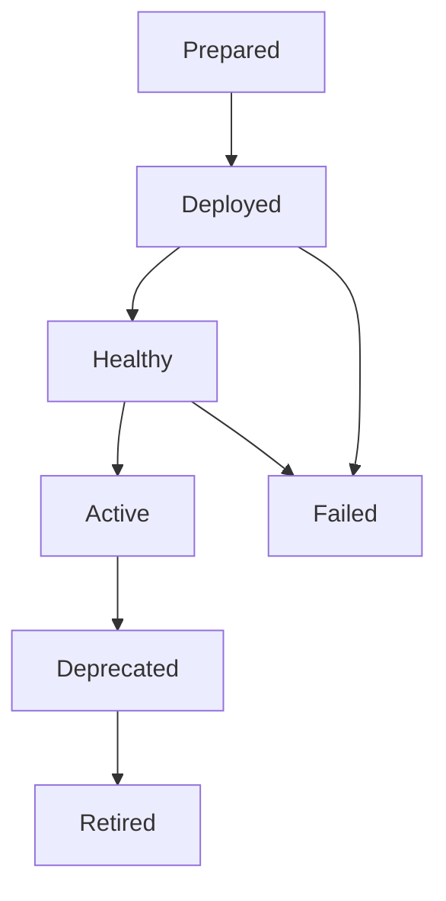

# Releases, routing, and client updates

## 1. Status and independent version axes

**Agreed:** retain backend releases concurrently; distinguish environments from releases; use semantic versioning; let developers choose client routing and required updates; support scheduled deadlines and client lockdown; version admin/index independently.

**Recommended:** the detailed policy schema, lifecycle, manifests, and operational controls below. Examples are proposed data shapes, not implemented protocols.

| Version axis | Meaning |
|---|---|
| Feature implementation release | Exact deployed feature code/configuration snapshot |
| Capability contract version | Interface used between independently maintained features |
| Application public API version | Contract presented to clients |
| Client app version/build | Platform-specific app implementation |
| Admin/index implementation version | Independently deployed control-plane code |
| Discovery/update-policy schema version | Stable contract consumed by all supported clients |
| Runtime configuration revision | Mutable settings snapshot validated against releases |

The user requested synchronized X in vX.Y.Z across clients and backend. Recommended interpretation: synchronize the application's public API major. Internal features can have independent versions; a future client supporting multiple API majors can declare that explicitly. The exact public versioning convention remains to be finalized.

## 2. Semantic compatibility — agreed

For stable releases starting at 1.0.0:

| Component | Meaning |
|---|---|
| X / major | Breaking changes to the declared public contract |
| Y / minor | Backward-compatible additions |
| Z / patch | Backward-compatible fixes |

Compatibility is directional. An older client should work with a newer compatible backend; a new client using added functionality may require a minimum minor version or capability.

A major API change requires compatible client support before migration, not necessarily immediate shutdown of clients using a retained older major. A backend/client version label is a promise; contract and integration tests must verify it. Pre-1.0 policy remains open.

## 3. Concurrent releases — agreed

Deploying authentication 1.0.1 must be able to preserve 1.0.0 and a working path for clients using it.

Lambda published versions provide numeric code/configuration snapshots. The release registry maps semantic releases to qualified Lambda versions/ARNs and immutable artifact hashes.

| Environment | Feature release | Example Lambda version | Example pinned route |
|---|---|---|---|
| prod | authentication 1.0.0 | 17 | /auth/releases/1.0.0/... |
| prod | authentication 1.0.1 | 18 | /auth/releases/1.0.1/... |

Aliases such as `release-1-0-0` can provide release-specific targets. Framework policy keeps a release alias pinned. A channel alias such as `api-v1` is deliberately movable.

Do not route retained production releases to unqualified `$LATEST`. Keep active aliases, routes, permissions, and infrastructure represented in desired state; deployment of a new release must not silently remove older supported declarations.

Published Lambda versions do not isolate databases, IAM role policy changes, external secrets, or downstream dependencies. Use separate physical functions/resources where release requirements demand stronger isolation. A release that requires a security fix may need a new artifact and deliberate channel/pinning policy rather than pretending an immutable artifact changed.

## 4. Client routing — agreed options

| Mode | Behavior |
|---|---|
| Exact pin | Uses a specific supported implementation release |
| Compatible channel | Uses the developer-approved release within a supported API major |
| Major migration | Selects the new major only after client compatibility is established |

Do not automatically select the numerically highest version or redirect across major versions. Binding should satisfy minimum minor/capability requirements too.

Each active feature release has its own resolved provider bindings. Two authentication releases may consume different email-validation contract versions concurrently.

Recommended: freeze release manifests with source commit, package versions, artifact hashes, contract requirements/resolved bindings, infrastructure schema, migration identifiers, runtime configuration schema, and client/API compatibility. Record environment-specific deployments separately. Promote identical artifacts across environments; generated AWS version numbers can differ.

### Capability advertisement and routing — proposed contract

A future request/discovery resolver can accept a bounded advertisement such as:

```json
{
  "schema_version": 1,
  "application": "example",
  "environment": "prod",
  "platform": "android",
  "client_build": 120,
  "api_major": 1,
  "route": {"mode": "channel", "name": "api-v1"},
  "requires_backend_capabilities": ["identity.passkey.create/v1"],
  "supports_protocol_features": ["update-policy/v1"]
}
```

This is a proposed wire shape; endpoint/header names and its implementation remain open. Keep backend capabilities required by the client distinct from protocol features the client can handle. A feature package version is not an application API major or platform build number.

The server resolves only the explicit environment and exact pin or developer-approved channel, checks supported advertisement schema/build policy, and verifies the selected release's declared API/capabilities and any supported minimum-version constraint. All requirements must be satisfied. Channel policy selects among approved healthy compatible targets; it does not automatically select the numerically highest release. An incompatible pin fails clearly rather than falling back to a channel or another environment/major.

Return selected release/endpoint, supported schema and policy revision, or a structured incompatibility/update response with safe recovery information. Define missing/unknown advertisements through an explicit legacy-support policy; do not infer compatibility from absence. Bound capability count/string size and keep responses within an intentional public metadata projection.

Treat all advertised values as untrusted compatibility hints. A client can lie about its version or capabilities. Backend authentication/authorization and operation/schema validation remain mandatory. Signing the advertisement alone does not establish a trustworthy client; stronger attestation is a separate requirement only where justified. Normal API requests enforce their selected route and effective update policy even after discovery succeeds.

## 5. Lifecycle and activation — recommended

Track deployment and activation separately:



A release is not advertised as active merely because resource creation succeeded. Readiness and smoke/contract checks precede activation.

Record failure checkpoints and recoverable operations. Rollback changes routing/configuration to a known compatible target; it does not automatically reverse database mutations. Retain the artifacts and dependencies needed for the promised rollback window.

## 6. Update policies and rollout — agreed direction

A developer may recommend or require an update for any release, including a patch. Compatibility and mandatory-update policy are separate decisions.

Recommended sequence:

1. Deploy the new backend alongside supported old releases.
2. Test and verify the new release without retiring the old one.
3. Publish mobile clients compatible with the target API and prepare the replacement website.
4. Confirm availability for affected platforms/regions/cohorts; store submission is insufficient.
5. Announce a future enforcement deadline.
6. At the deadline, enforce the minimum supported contract/build for the affected clients.
7. Retire old infrastructure only after dependency, work-drain, and retention checks.

A backend deployment may create a pending policy with a relative delay. Recommended: convert the delay into a fixed server timestamp when the readiness/availability gate is satisfied, rather than starting an irreversible countdown before clients are available.

Policies are scoped by application, environment, platform, and optionally feature/cohort. Support cancellation, extension, and replacement through higher revisions, including emergency immediate enforcement when deliberately selected.

Proposed policy:

```json
{
  "schema_version": 1,
  "revision": 42,
  "environment": "prod",
  "mode": "required",
  "required_api_major": 2,
  "enforce_after": "2027-01-15T18:00:00Z",
  "minimum_client_builds": {
    "android": 120,
    "ios": 87,
    "web": 205
  },
  "message": "Update before the deadline to continue.",
  "update_urls": {
    "android": "...",
    "ios": "...",
    "web": "..."
  }
}
```

Minimum builds are compared within the same client application/platform/channel; API versions and platform build numbers are different quantities. The timestamp is illustrative, not an actual scheduled update.

## 7. Request protocol and enforcement — agreed behavior, recommended mechanism

Clients enter lockdown when a required policy becomes effective. This means restricting affected operations and showing the update path, not remotely installing software.

| Mechanism | Purpose |
|---|---|
| Request client identity, platform, version/build | Identify the applicable client policy |
| Explicit API route or contract identifier | Identify the API being requested |
| Stable discovery/policy endpoint | Fetch policy, routes, messages, and update destinations |
| Policy revision on responses | Signal that a cached policy needs refreshing |
| Server-side request enforcement | Reject unsupported protected operations after cutoff |

The full deadline/message does not need to appear in every response header. A small revision indicator can prompt refresh. On startup, foreground/resume, bounded periodic refresh during long sessions, and revision change, clients retrieve current policy.

Clients cache the policy for notice/countdown and recheck when resuming from sleep. The server's clock governs enforcement. Return server time so clients can display an accurate countdown despite clock skew.

Unsupported requests receive a stable structured `CLIENT_UPDATE_REQUIRED` error with the policy revision and recovery/update information. Exact HTTP status/header names remain open. Discovery/policy and recovery endpoints must remain reachable.

Client-reported versions are compatibility signals, not proof that trusted code is running. Do not replace authentication/authorization with version headers.

Recommended: all clients use a common protocol specification and platform SDK/middleware so handling is consistent. Define missing-version behavior, offline policy expiry, scoped lockdown, in-flight operation handling, policy rollback/unlock, and behavior when an update cannot be downloaded. A client that missed all notices must still be rejected by backend enforcement.

Lockdown should preserve user data and allow update/recovery. The app cannot guarantee instantaneous local lockdown while offline, suspended, or terminated; backend access remains enforceable on the next request.

## 8. Website/PWA updates — agreed intent

Show advance notice with the deadline rendered in the user's local timezone. Offer "Update now" once the replacement is available.

Recommended implementation:

- Preserve drafts and stop starting affected operations at cutoff.
- Fetch/activate the compatible web release and reload deliberately.
- Retain old content-hashed assets while supported sessions may need them.
- Handle installed service workers explicitly; a normal reload may leave an old worker controlling a page.
- Verify the loaded build after reload; avoid infinite reload loops.
- Handle multiple open tabs and stale cached discovery/policy.
- Keep accessible update/recovery UI available after lockdown.
- Do not expose a required new API before the corresponding website is available.

## 9. Runtime/data compatibility — recommended

- Add schema fields/indexes before code requires them.
- Backfill and validate data before changing assumptions.
- Delay destructive removal until all supported code and rollback targets no longer depend on it.
- Version event/message schemas and resolve compatible workers.
- Make retryable operations idempotent; drain queues and account for delayed retries before retirement.
- Validate runtime setting changes against every affected release.
- Track secrets/key rotation compatibility and old verification requirements.
- Do not assume a retained Lambda alone preserves a usable old release.

### Configuration revisions and retained Lambda versions

Configuration changes follow the source/application mechanism in [Configuration and administration](configuration-and-administration.md). Published Lambda environment variables are immutable: changing them requires a new Lambda version, potentially using identical code, and deliberate alias/routing activation. Track code artifact identity, configuration revision, and qualified Lambda target separately. Do not silently repoint exact release pins or assume a configuration-only rollout changes the public API major.

External configuration/secret references may remain mutable even when code is pinned. Record their revision/stage/refresh policy and validate changes against affected releases. Whether a change targets one release or all compatible active releases remains an explicit open policy choice.

## 10. Retirement — recommended

An explicit retirement plan checks:

- Active client routes and release/provider bindings.
- Traffic and errors over an agreed observation window; lack of traffic alone is insufficient.
- Outstanding asynchronous jobs, retries, subscriptions, and integrations.
- Shared resources and ownership.
- Artifact/data retention and rollback commitments.
- Published deadlines and platform availability.
- Discovery/configuration references and secret/key dependencies.

Deprecation removes neither route nor infrastructure automatically. Retirement updates the authoritative desired state deliberately, then reconciles removal. Security-driven blocking may precede physical cleanup.

## 11. References

- [Semantic Versioning 2.0.0](https://semver.org/spec/v2.0.0.html)
- [AWS Lambda versions](https://docs.aws.amazon.com/lambda/latest/dg/configuration-versions.html)
- [AWS Lambda aliases](https://docs.aws.amazon.com/lambda/latest/dg/configuration-aliases.html)
- [Pulumi Lambda alias](https://www.pulumi.com/registry/packages/aws/api-docs/lambda/alias/)
- [Service worker lifecycle](https://web.dev/learn/pwa/service-workers)
